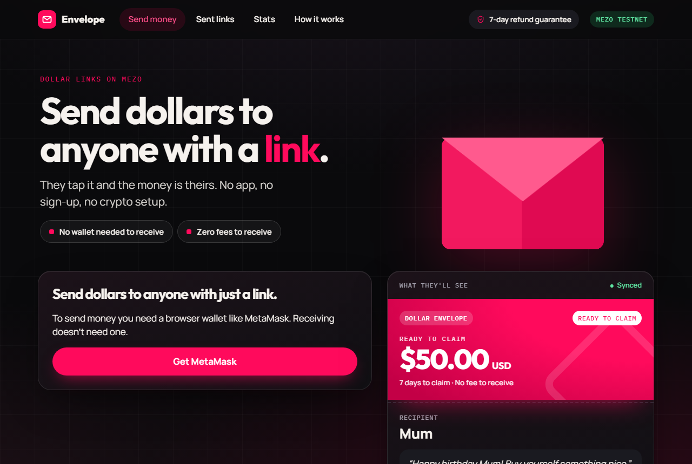
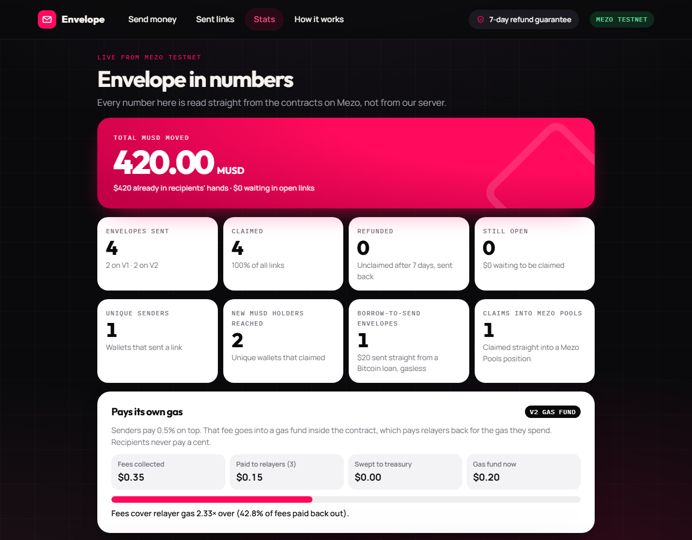
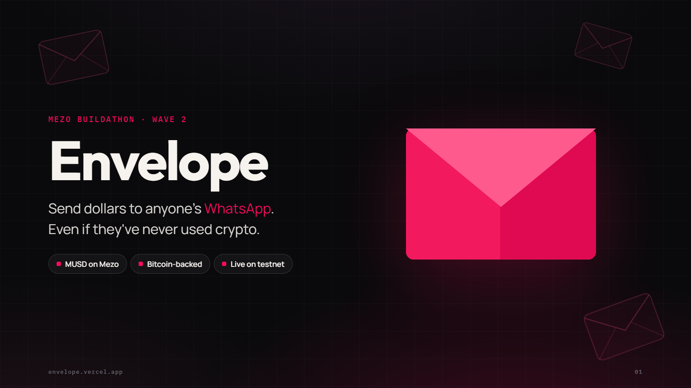

# Envelope

[](https://github.com/imprint-hash/envelope/actions/workflows/test.yml)

**Send dollars to anyone's WhatsApp, even if they have never used crypto.**

Your cousin in Houston sends $50 in MUSD. Your mum gets a WhatsApp message with a link, taps it, and the $50 is hers. She does not install an app, sign up, or pay a fee. If nobody claims it within 7 days, the money goes back to the sender.

- **Live (Mezo testnet):** https://envelope.vercel.app · live numbers: https://envelope.vercel.app/stats · pitch deck: https://envelope.vercel.app/deck/
- **Track:** Access & Distribution, Mezo Buildathon Wave 2
- **EnvelopeV2 (Wave 2, verified):** [`0x06b4B5A507FDb61d6d082007ab48aD76B26dFa26`](https://explorer.test.mezo.org/address/0x06b4B5A507FDb61d6d082007ab48aD76B26dFa26)
- **LinkEscrow (Wave 1, verified, still serves old links):** [`0x2330b264BF90E94F4926fD819c1281F799005c01`](https://explorer.test.mezo.org/address/0x2330b264BF90E94F4926fD819c1281F799005c01)
- **Token:** testnet MUSD [`0x118917a40FAF1CD7a13dB0Ef56C86De7973Ac503`](https://explorer.test.mezo.org/address/0x118917a40FAF1CD7a13dB0Ef56C86De7973Ac503) · chain 31611

> **Judges, start here (2 minutes, no wallet needed)**
> 1. Open the [live stats](https://envelope.vercel.app/stats): every number is read straight from the contracts, including the borrow-to-send envelope, the Mezo Pools claim and the gas fund.
> 2. Click the three Wave 2 transactions below: a [real Mezo borrow](https://explorer.test.mezo.org/tx/0x1dcd6c488bde2e988effd742ff0137a6ee91367dc883cf6e39493dbd99d8905f), the [envelope it funded](https://explorer.test.mezo.org/tx/0x0103df33cf59763c010dff9b09b6833d5c6622224a6240b54a3be08c45724fa6), and a [claim straight into Mezo Pools](https://explorer.test.mezo.org/tx/0xccc8266439135fc8bee0046bb1d91a12c5063934f17b48c5e10051100a1eb7fb).
> 3. Flip through the [deck](https://envelope.vercel.app/deck/) ([PDF](docs/Envelope-deck.pdf)).
> 4. Want to try it? Get test BTC at [faucet.test.mezo.org](https://faucet.test.mezo.org), open [envelope.vercel.app](https://envelope.vercel.app) and send yourself a link.

| Send | Live stats | Deck |
|---|---|---|
|  |  |  |

## What's new in Wave 2

| Wave 1 judge feedback | What we built | Proof |
|---|---|---|
| "Integration is plain ERC-20 / permit. Build borrowing via BorrowerOperations, or route claims into Mezo savings / Pools." | **Send from your Bitcoin:** borrow MUSD against your BTC through Mezo's `BorrowerOperationsSignatures.withdrawMUSDWithSignature` and send it as an envelope. 3 signatures, $0 gas. A **loan-health guard** reads Mezo's TroveManager, PriceFeed and BorrowerOperations and blocks any send that would push you below 120%. **Claim options:** recipients can claim straight into a **Mezo Pools** MUSD/mUSDC position ("Keep it earning") or swap a little MUSD to BTC for gas ("A little BTC for fees"). | [`contracts/EnvelopeV2.sol`](contracts/EnvelopeV2.sol), [`api/borrow-send.mjs`](api/borrow-send.mjs), fork tests against Mezo's live contracts, [on-chain proof](docs/PROOF.md) |
| "Verify LinkEscrow." | Both contracts verified on the Mezo explorer. | links above |
| "Add a pitch deck." | 11-slide deck. | [envelope.vercel.app/deck](https://envelope.vercel.app/deck/) |
| "How is relayer gas paid? Escrow fee or off-ramp revenue share." | **Gas that pays for itself:** a 0.5% fee, paid by the sender on top (the recipient always gets the full amount), goes into an on-chain gas fund. Every relayed transaction pays the relayer back from that fund, capped at half the envelope's fee. Surplus can only go to a fixed treasury. No owner, no admin keys. | `gasFund()`, `RelayerPaid` events, [stats page](https://envelope.vercel.app/stats) |

Also new: a live **Stats** page read straight from the contracts, a **"Send it forward"** card after every claim (growth loop), a [threat model](docs/THREAT_MODEL.md), CI on every push, and an Alibi-style redesign.

## Proof it works (Mezo testnet)

Wave 2 transactions are listed in [`docs/PROOF.md`](docs/PROOF.md). The first ones:

- EnvelopeV2 deployed and verified: [`0x731b43e5…`](https://explorer.test.mezo.org/tx/0x731b43e5b7bfb45f940bd0970fd31bb565f5e6ed8386bc57c5b4b30936fc149c)
- $50 envelope sent; the sender paid the $0.25 fee on top into the gas fund: [`0xccff6b05…`](https://explorer.test.mezo.org/tx/0xccff6b05b52011c02268086a7e1affe806c2143018a6ab34a804bdf2d5b8246d)
- Claimed with $0 gas; the relayer was paid back $0.05 from the gas fund: [`0xe9eb48df…`](https://explorer.test.mezo.org/tx/0xe9eb48df7d509afc4f4d87a56a856896898dfff2bf7e2867ad328c62610ca093)
- Mezo loan: borrowed 20.1 MUSD against BTC via `withdrawMUSDWithSignature` (relayer paid gas, sender signed): [`0x1dcd6c48…`](https://explorer.test.mezo.org/tx/0x1dcd6c488bde2e988effd742ff0137a6ee91367dc883cf6e39493dbd99d8905f)
- "Pay from my Bitcoin": $20 envelope via `createFor` (permit + CreateFor signature, fee to gas fund, relayer paid back): [`0x0103df33…`](https://explorer.test.mezo.org/tx/0x0103df33cf59763c010dff9b09b6833d5c6622224a6240b54a3be08c45724fa6)
- "Keep it earning": claimed straight into a Mezo Pools MUSD/mUSDC LP position via `claimWithOption` (mode EARN): [`0xccc82664…`](https://explorer.test.mezo.org/tx/0xccc8266439135fc8bee0046bb1d91a12c5063934f17b48c5e10051100a1eb7fb)

Wave 1: envelope #1 created ([`0xf6f3b976…`](https://explorer.test.mezo.org/tx/0xf6f3b97655d491f7075631c9317bf2cb457932c4bb926c72cdc5bcb4f59eff5c)) and claimed by a brand-new phone wallet ([`0x120b9ca5…`](https://explorer.test.mezo.org/tx/0x120b9ca57a235ab7432f89164956139f0e675f6406aa2e7d7e45d98a48addcb3)).

## Why

Sending $200 to Sub-Saharan Africa costs **8.46%** on average, the most expensive region in the world (World Bank Remittance Prices Worldwide, Q3 2025). Crypto could fix this, but the person receiving needs a wallet, the right network and BTC for gas. Envelope removes all three: the person receiving needs nothing but a phone and a link. Every claimed envelope is a new MUSD holder on Mezo.

Existing MUSD payment apps (usernames, requests, tabs) assume both people already have wallets. Envelope is for the person who has nothing yet.

## How Mezo is used

| Mezo contract | What Envelope calls | Why |
|---|---|---|
| BorrowerOperationsSignatures | `withdrawMUSDWithSignature`, `getNonce` | Gasless borrow-to-send |
| BorrowerOperations | `getBorrowingFee`, `borrowingRate`, `MCR`, `CCR` | Exact cost and safety lines |
| TroveManager | `getTroveStatus`, `getEntireDebtAndColl`, `getCurrentICR`, `checkRecoveryMode` | Loan-health guard |
| PriceFeed | `fetchPrice` | Live BTC price |
| Mezo Pools Router | `addLiquidity`, `swapExactTokensForTokens`, `quoteStableLiquidityRatio`, `poolFor` | Claim into an LP position, or into a little BTC |
| MUSD | EIP-2612 `permit`, transfers | One-signature funding |

## How it works

**Send from your Bitcoin** (the sender signs 3 messages and pays no gas):

```
Sender wallet (has a Mezo trove)       Relayer (api/borrow-send.mjs)         Mezo + EnvelopeV2
  1. signs WithdrawMUSD (Mezo EIP-712) ─►
  2. signs MUSD Permit                ─► checks trove, price, ICR after
  3. signs CreateFor (Envelope EIP-712)─► the borrow; refuses < 120% or
                                         recovery mode; simulates both
                                         calls, then:
                                         withdrawMUSDWithSignature ────────►  MUSD lands in the SENDER's wallet
                                         createFor ─────────────────────────►  pulls amount + 0.5% fee, locks amount,
                                                                               fee → gas fund, relayer paid back
```

**Claim** (unchanged for the recipient: tap the link, the money is theirs):

```
Recipient phone                        Relayer (api/claim.mjs)               EnvelopeV2
  link /c#v2-<id>.<link key>
  page makes a wallet in the browser
  link key signs Claim / ClaimOption ─► checks, simulates ─────────────────►  claimFor: MUSD to recipient
                                                                              claimWithOption: MUSD/mUSDC LP, or
                                                                              MUSD + a little BTC (slippage-protected)
                                                                              relayer paid back from the gas fund
```

- The link key lives only in the URL **fragment** (`#...`), which browsers never send to a server.
- The `CreateFor` signature binds the link address, so a relayer can never swap in its own link key. The borrowed MUSD always lands in the sender's own wallet first, so a front-runner can't orphan it.
- Not claimed in 7 days: `refund(id)` sends it back to the sender (anyone can trigger it; it always pays the sender).

## Security model

- EIP-712 signatures bound to the contract, chain id, envelope id and recipient (plus mode, minimum output and deadline for claim options). No redirecting, no replay across envelopes, chains or contracts. Low-s and `v` checks, zero-address rejection.
- Each envelope moves once: Open → Claimed or Open → Refunded.
- Reentrancy guard, checks-effects-interactions, checked transfers.
- Fee is immutable and capped at 1% in the constructor; relayer reward ≤ 1 MUSD and never more than half the envelope's fee; envelope money is never used for gas.
- Relayers: input shape → on-chain state → signature → simulation before any gas is spent; per-IP rate limit; never logs bodies or keys; never holds user money.
- Full write-up: [`docs/THREAT_MODEL.md`](docs/THREAT_MODEL.md).

**Known limit:** anyone who has the link can claim it, like cash in an envelope. The send page says so before you share it.

## Tests

220 passing tests, run in CI on every push:

```bash
forge test --no-match-path "test/*fork*"                                   # 184 contract tests
forge test --match-path "test/*fork*" --fork-url https://rpc.test.mezo.org # 5 fork tests on Mezo's live contracts
node --test test/node/*.test.mjs                                           # 31 web / relayer tests
```

- Unit tests for every path and revert, fuzz tests on amounts and fees, and an invariant: `MUSD.balanceOf(envelope) == sum(open envelopes) + gasFund`.
- Attack tests: wrong signer, replayed signatures, swapped link, front-run permit, reentrancy, slippage.
- Fork tests open a real trove on Mezo testnet, sign a real `WithdrawMUSD`, relay it, then `createFor` → `claimFor`, and claim into the real Mezo Pools.
- Gas: `claimFor` ~72k, `createFor` ~301k, claim into Pools ~573k ([report](docs/gas-report-v2.txt)).

## Run it yourself

1. Get test BTC from https://faucet.test.mezo.org and open a trove / borrow test MUSD at https://testnet.mezo.org.
2. `cp .env.example .env` and set `RELAYER_PRIVATE_KEY` (a test-only key with a little test BTC) and `RPC_URL=https://rpc.test.mezo.org`.
3. Deploy: `DEPLOYER_PRIVATE_KEY=... TREASURY_ADDRESS=0x... forge script script/DeployV2.s.sol --rpc-url https://rpc.test.mezo.org --broadcast`
4. Put the address in `ESCROW_ADDRESS_V2` (`.env`) and in `public/js/config.js`.
5. `npm install`, then deploy to Vercel with `RELAYER_PRIVATE_KEY`, `ESCROW_ADDRESS`, `ESCROW_ADDRESS_V2` and `RPC_URL` set.

## Next

Mainnet with real MUSD (claim straight into Mezo's MUSD Savings Vault) · cash-out partners with an off-ramp revenue share · group envelopes for weddings and birthdays · monthly family support borrowed against BTC you keep.
